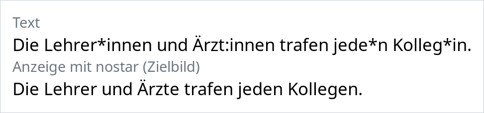

# nostar

[Deutsch](README.de.md)

Displays German gender forms on the whole Linux desktop in the generic masculine, without a browser extension.



`nostar` does not change any text. It builds rules into copies of your fonts (OpenType `calt`), so `Lehrer*innen` is drawn as "Lehrer" and `Ärzt:innen` as "Ärzte". Copying, searching and saving still see the original text.

1. A dictionary of about 4,500 German person nouns ([Entgendert](https://github.com/janduettmann/Entgendert), from Wiktionary) becomes a rule list.
2. The rules go into copies of your fonts under `~/.local/share/fonts/nostar/`.
3. A fontconfig rule makes programs use the copies instead of the originals.

No system files are changed and no root rights are needed.

## Installation

- Debian, Ubuntu: `.deb` from the [releases page](https://github.com/NoahJeanA/nostar/releases)
- Fedora, openSUSE: `.rpm` from the releases page
- Arch Linux: AUR package `nostar` or `nostar-bin`
- With Rust 1.89 or later: `cargo install nostar`

Needed at runtime: fontconfig (`fc-list`, `fc-match`, `fc-cache`) and `curl`; `gsettings` is optional (GNOME fonts).

Run `nostar remove` before uninstalling the package: the package only removes the program, not the copies in your home directory.

## Usage

```sh
nostar data update      # download the dictionary (fixed version, checksum)
nostar rules build      # build and test the rule list
nostar apply            # patch fonts and activate them
```

Then restart running programs.

```sh
nostar show "jede*r Kolleg*in"   # what would be displayed? -> jeder Kollege
nostar status                    # what is patched, what is outdated?
nostar remove                    # undo everything
```

Configuration: `~/.config/nostar/config.toml`, see [TECHNIK.md](TECHNIK.md), section 5.

## Limits

- Works only where programs use system fonts. Web fonts, PDFs, Electron apps and text in images stay unchanged.
- No grammar: "mit den Lehrer\*innen" becomes "mit den Lehrer".
- A word drawn in pieces (partly bold, line break inside) is not changed.

## Fonts

`nostar` modifies copies of your installed fonts and keeps their names. The copies are for your own use only; do not pass them on. Some licenses (e.g. the OFL with a Reserved Font Name, as for Liberation) allow modified versions only under a different name. Use `exclude` for fonts you may not modify.

## Documentation

The specification ([SPEZIFIKATION.md](SPEZIFIKATION.md)) and the technical design ([TECHNIK.md](TECHNIK.md)) are in German.

## License

`nostar`: GPL-3.0-or-later, see [LICENSE](LICENSE).

Dictionary data: CC BY-SA 4.0 (Entgendert, Wiktionary). It is downloaded by `data update` and not distributed with `nostar`.

Test data with their own licenses: fonts in `tests/fixtures/` (OFL, see `OFL.txt`), dictionary excerpt `tests/fixtures/dictionary.js` (CC BY-SA 4.0), reference texts in `tests/bench/` (CC BY-SA 3.0 and PSF, see `tests/bench/README.md`).
