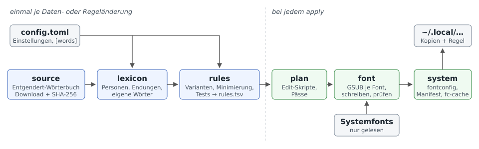
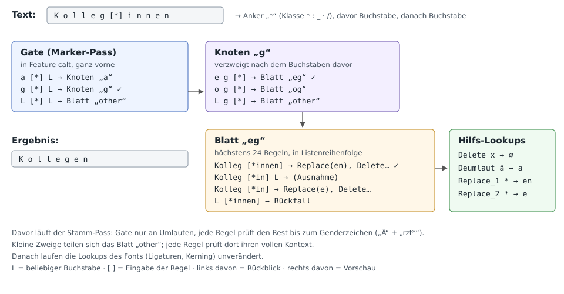

# Technische Spezifikation: `nostar`

Status: Entwurf 2 · Stand: 2026-10-27 · Grundlage: [SPEZIFIKATION.md](SPEZIFIKATION.md) (Entwurf 3)

Dieses Dokument legt fest, **wie** `nostar` gebaut wird. **Was** das Programm tut, steht in der fachlichen Spezifikation. Abweichungen davon sind in Abschnitt 15 gesammelt (freigegeben am 2026-10-26 und 2026-10-27). Abschnitte 8 und 9 sind nach dem Spike (Meilenstein 1) überarbeitet.

---

## 1. Leitlinien

| Leitlinie | Bedeutung für den Code |
|---|---|
| **Nur Spezifiziertes** | Keine Funktion, Option oder Abhängigkeit ohne Grundlage in einer der beiden Spezifikationen |
| **Klare Zuständigkeit** | Jedes Modul hat genau eine Aufgabe (Abschnitt 3). Module reden über Datentypen miteinander, nicht über Dateien. |
| **Klein** | Wenige Abhängigkeiten (Abschnitt 4), keine asynchrone Laufzeit, keine Plugins, keine Hintergrunddienste |
| **Nachvollziehbar** | Jede Änderung am System wird protokolliert (Abschnitt 11) |
| **Englisch im Code** | Bezeichner, Kommentare, Log- und Fehlermeldungen auf Englisch; Meldungen kurz und konkret (Abschnitt 12) |

## 2. Gesamtablauf



```
config.toml ─┐
             ▼
 source ──► lexicon ──► rules ──► plan ──► font ──► system
 (Download,  (Wörter-    (Regel-   (Edit-    (GSUB pro   (fontconfig,
  Prüfsumme)  buch)       liste)    skripte,  Font, prüfen) Manifest)
                                    Pässe)
```

1. **source:** lädt das Entgendert-Wörterbuch in fester Version und prüft die Prüfsumme.
2. **lexicon:** liest das Wörterbuch ein und ergänzt es um die eigenen Wörter aus `config.toml`.
3. **rules:** erzeugt die Regelliste, minimiert und ordnet sie und prüft sie gegen die Testsammlung.
4. **plan:** übersetzt die Regeln in zeichenbasierte Edit-Skripte und teilt sie auf Pässe auf. Das ist noch unabhängig von einem Font.
5. **font:** baut den Plan pro Font in die GSUB-Tabelle ein, schreibt die Kopie und prüft sie.
6. **system:** schreibt die fontconfig-Regel und das Manifest und ruft `fc-cache` auf.

Schritte 1–3 laufen einmal je Daten- oder Regeländerung, Schritte 4–6 bei `apply`.

## 3. Module und Zuständigkeiten

Ein einziges Crate (`nostar`) mit Bibliothek und Binary, keine Workspace-Aufteilung. `lib.rs` bindet alle Module ein, damit die Integrationstests in `tests/` sie erreichen; `main.rs` enthält nur die CLI.

```
src/
├── main.rs            CLI-Definition, Befehlsaufruf, Exit-Codes
├── lib.rs             Modulbaum, Typ `Error`
├── config.rs          config.toml lesen und prüfen
├── paths.rs           alle Pfade (XDG)
├── log.rs             Logger (stderr + Datei)
├── fsutil.rs          atomares Schreiben, Sperrdatei, SHA-256
├── source.rs          Wörterbuch laden, prüfen, parsen
├── lexicon.rs         Wörterbuch-Modell + eigene Wörter
├── rules/
│   ├── mod.rs         Typen: Rule, Pattern, Marker, Stage, Boundary
│   ├── fixed.rs       Stufe 1: feste Formen, Partizipien
│   ├── build.rs       lexicon → Regelliste (Varianten, Minimierung, Ordnung)
│   ├── edit.rs        Edit-Skript, Anker und Pass je Regel
│   ├── engine.rs      Referenz-Umsetzung auf Text
│   └── store.rs       rules.tsv lesen/schreiben
├── plan.rs            Regeln → Pässe, Gate- und Baum-Schlüssel (zeichenbasiert)
├── font/
│   ├── mod.rs         Patch eines Fonts: lesen → kompilieren → schreiben → prüfen
│   ├── select.rs      Kandidaten über fontconfig
│   ├── glyphs.rs      Zeichen → Glyphen, Buchstabenmenge, Ausschlussprüfung
│   ├── compile.rs     Plan → GSUB-Lookups (glyphenbasiert)
│   ├── gsub.rs        Lookups in bestehende GSUB einfügen, Indizes verschieben
│   └── verify.rs      Formung mit harfrust, Vergleich Original/Kopie
├── system/
│   ├── fontconfig.rs  99-nostar.conf schreiben, fc-cache
│   └── manifest.rs    manifest.toml lesen/schreiben
└── cmd/
    ├── data.rs        nostar data update
    ├── rules.rs       nostar rules build | test
    ├── show.rs        nostar show
    ├── apply.rs       nostar apply
    ├── status.rs      nostar status
    └── remove.rs      nostar remove
tests/
├── cases.tsv          Testsammlung (SPEZIFIKATION 13.1)
├── fixtures/          kleiner Latin-Font (OFL) für Font-Tests
├── engine.rs          Regelliste gegen cases.tsv
├── font.rs            Patch + Prüfung am Fixture-Font
└── bench/             Referenztexte für die Geschwindigkeit (prose.txt, code.txt, marked.txt)
tools/
├── hbcmp.c            Messwerkzeug: zwei Fonts abwechselnd mit HarfBuzz (C) formen
└── bench.sh           Fonts patchen und gegen fachl. Spezifikation 8.3 messen
```

### 3.1 Abhängigkeiten zwischen Modulen

Abhängigkeiten zeigen nur nach unten. `cmd/*` ist die einzige Schicht, die mehrere Fachmodule zusammenführt.

```
cmd ──► source, lexicon, rules, plan, font, system
font ──► plan, rules (Typen)
plan ──► rules (Typen)
rules ──► lexicon
alle ──► config, paths, log, fsutil
```

Verboten: `rules` kennt keine Fonts, `font` kennt kein Dateisystem außer Ein- und Ausgabepfad, `system` kennt keine Regeln.

## 4. Abhängigkeiten (Crates)

| Crate | Zweck | Begründung |
|---|---|---|
| `clap` (Feature `derive`) | Kommandozeile | Hilfe-Texte und Fehlermeldungen ohne eigenen Code |
| `serde` (Feature `derive`), `toml` | `config.toml`, `manifest.toml` | Vorgabe TOML |
| `read-fonts`, `write-fonts` | Fonts lesen, GSUB bauen, Font schreiben | Einzige gepflegte Rust-Bibliothek, die bestehende Tabellen verändern und neu schreiben kann |
| `harfrust` | Formung bei der Prüfung (9.6) | Rust-Portierung von HarfBuzz, keine C-Abhängigkeit |
| `sha2` | Prüfsummen | |
| `thiserror` | Fehlertypen | |
| `log` | Log-Schnittstelle | Eigener Logger, siehe Abschnitt 11 |
| `unicode-properties` | Unicode-Kategorie „Letter“ | `char::is_alphabetic` umfasst mehr als Kategorie L |

**Nicht** verwendet: `anyhow`, `tokio`, HTTP-Clients, `regex`, `chrono`, `rayon`, Logging-Frameworks.

Externe Programme (per `std::process::Command`): `fc-list`, `fc-match`, `fc-cache`, `curl` (nur `data update`).

Entwicklerwerkzeug, nicht Teil des Programms: HarfBuzz (C) für die Geschwindigkeitsmessung (9.7, 14.1).

Versionen werden über `Cargo.lock` fixiert. Mindestversion Rust: 1.89 (für `File::try_lock`).

## 5. Konfiguration

Datei: `$XDG_CONFIG_HOME/nostar/config.toml`. Fehlt sie, gelten die Voreinstellungen. Unbekannte Schlüssel sind ein Fehler (`#[serde(deny_unknown_fields)]`).

```toml
# Fonts: "standard" or "all"
mode = "standard"
families = ["Adwaita Sans", "JetBrains Mono"]
exclude = []                       # family names or absolute paths

# Recognition
markers = ["*", ":", "_", "·", "/", "/-"]
binnen_i = true
fallback = "cut"                   # "cut" | "marker" | "off"
participles = false
skip_monospace = false

[source]
commit = "febca802f868c4ce968bbae70c099cdbc0454e18"
sha256 = "6330c126964385e84fb5f01c47893a2a75a65b163f6be4bd19bc2448517f73b3"

# Own words, take precedence over the dictionary.
# Key: feminine stem as written before the marker.
[words.Freund]
singular = "Freund"
plural = "Freunde"
compound = "Freundes"              # optional, default: plural
```

Stämme mit Umlaut oder ß müssen in Anführungszeichen stehen, weil TOML nur ASCII-Schlüssel ohne Anführungszeichen erlaubt: `[words."Ärzt"]`.

| Schlüssel | Typ | Prüfung |
|---|---|---|
| `mode` | Enum `standard` \| `all` | |
| `families`, `exclude` | Liste von Strings | nicht leer; Pfade müssen absolut sein |
| `markers` | Liste aus `* : _ · / /-` | keine Duplikate, keine anderen Werte |
| `binnen_i`, `participles`, `skip_monospace` | bool | |
| `fallback` | Enum `cut` \| `marker` \| `off` | |
| `source.commit` | 40 Hex-Zeichen | |
| `source.sha256` | 64 Hex-Zeichen | |
| `words.<stamm>` | `singular`, `plural` Pflicht, `compound` optional | nur Buchstaben; Stamm beginnt mit Großbuchstaben |

## 6. Pfade

Alle Pfade entstehen ausschließlich in `paths.rs` und respektieren `XDG_CONFIG_HOME`, `XDG_DATA_HOME`, `XDG_STATE_HOME`.

| Zweck | Pfad |
|---|---|
| Konfiguration | `~/.config/nostar/config.toml` |
| Wörterbuch | `~/.local/share/nostar/source/entgendert-<commit12>.js` |
| Regelliste | `~/.local/share/nostar/rules.tsv` |
| Gepatchte Fonts | `~/.local/share/fonts/nostar/<Originalpfad ohne führenden />` |
| fontconfig-Regel | `~/.config/fontconfig/conf.d/99-nostar.conf` |
| Manifest | `~/.local/state/nostar/manifest.toml` |
| Log | `~/.local/state/nostar/nostar.log` |
| Sperrdatei | `~/.local/state/nostar/lock` |

## 7. Datenquelle (`source.rs`, `lexicon.rs`)

### 7.1 Laden

`nostar data update` ruft auf:

```
curl --fail --silent --show-error --location --max-time 60 --output <tmp> \
  https://raw.githubusercontent.com/janduettmann/Entgendert/<commit>/extension/dictionary.js
```

Danach SHA-256 prüfen. Stimmt sie, wird die Datei atomar an ihren Platz verschoben. Sonst wird sie gelöscht und ein Fehler gemeldet.

### 7.2 Format

`dictionary.js` enthält vier String-Felder: `irregular`, `regular`, `adjectival`, `rules`. `source.rs` liest genau diese vier Felder aus (Suche nach `<feld>: "` bis zum nächsten `"`; vor dem Feldnamen darf kein Buchstabe, keine Ziffer und kein `_` stehen, sonst fände die Suche nach `regular` das Feld `irregular`). Ein weitergehender JavaScript-Parser ist nicht nötig, weil die Datei über die Prüfsumme fixiert ist.

| Feld | Aufbau | Bedeutung |
|---|---|---|
| `irregular` | `stamm,a,b[,c[,a]]` getrennt durch `;` | Singular = decode(stamm, a), Plural = decode(Singular, b), Dativ = decode(Plural, c), fehlt `c`, ist der Dativ gleich dem Plural; Flag `a` = adjektivisch |
| `regular` | `stamm` getrennt durch `;` | Singular = Plural = stamm |
| `adjectival` | Wörter getrennt durch `;` | substantivierte Adjektive („Vorsitzende“) |
| `rules` | `endung=s,p,d` oder `endung=!` | Endungsregel; Singular = endung + s, Plural = endung + p (an die Endung angehängt, ohne decode; `eg=e,en,en` → `ege`, `egen`); `!` = keine Regel |

decode(basis, code): leer → basis; beginnt mit `+` → basis + Rest; sonst → code.

Jeder Stamm und jede Form muss aus Buchstaben (Unicode-Kategorie L) bestehen. Ein ungültiger Eintrag bricht mit Feld und Eintrag in der Meldung ab. Beim Laden wird die Prüfsumme erneut geprüft.

### 7.3 Modell

```rust
pub struct Person {
    pub stem: String,          // "Ärzt"
    pub singular: String,      // "Arzt"
    pub plural: String,        // "Ärzte"
    pub compound: String,      // "Ärzte" (default: plural)
    pub origin: Origin,
}
pub struct EndingRule { pub ending: String, pub singular: String, pub plural: String }
pub enum Origin { Entgendert { commit: String }, Config, Builtin }
pub struct Lexicon { pub persons: Vec<Person>, pub endings: Vec<EndingRule>, pub adjectival: Vec<String> }
```

Einträge aus `[words]` ersetzen gleichnamige Stämme aus dem Wörterbuch. Der Dativ wird gelesen, aber in Version 1 nicht verwendet (fachl. Spezifikation 4.6).

## 8. Regeln (`rules/`)

### 8.1 Typen

```rust
pub enum Stage { Fixed = 1, Lexicon = 2, Ending = 4, Fallback = 5 }
pub enum Marker {
    Gender,          // one of the active markers * : _ · /
    GenderNoSlash,   // one of the active markers * : _ · (stage 5 only)
    SlashHyphen,     // Gender followed by '-'
    BinnenI,
}
pub enum Right { WordEnd, Any }       // Any: compound part may follow
pub struct Rule {
    pub stage: Stage,
    pub left_boundary: bool,         // only stage 1: no letter before the stem
    pub stem: String,                // exact characters before the marker
    pub marker: Marker,
    pub suffix: String,              // "innen", "in", "r", ...
    pub right: Right,
    pub target: String,              // replacement for stem + marker + suffix
    pub origin: Origin,
}
```

Stufe 2 und 3 der fachlichen Spezifikation fallen zusammen. Eine Stamm-Regel prüft nur das **Ende** des Wortes. „Stammkund\*innen“ trifft dadurch die Regel für „kund“ (Variante mit kleinem Anfangsbuchstaben), Abschnitt 15, Punkt 4.

Die aktiven Genderzeichen bilden **eine** Klasse (`Marker::Gender`). Im Font sind sie eine Glyphenklasse (9.4). Getrennte Regeln je Zeichen würden die Regelzahl verfünffachen, ohne das Ergebnis zu ändern.

### 8.2 Erzeugung (`build.rs`)

Für jede `Person`:

| Variante | Stamm | Endung | Ziel | `right` |
|---|---|---|---|---|
| Plural | `Ärzt` | `innen` | `Ärzte` | `Any` |
| Singular | `Ärzt` | `in` | `Arzt` | `WordEnd` |

Jede Variante wird vervielfacht über:
- **Schreibweise des Stamms:** Original (`Ärzt`), kleiner Anfang (`ärzt`, für Zusammensetzungen), Großbuchstaben (`ÄRZT`). Bei Großbuchstaben werden Endung und Ziel ebenfalls großgeschrieben.
- **Endung mit großem I:** `innen` und `Innen`, `in` und `In`
- **Genderzeichen:** `Gender` und, wenn `/-` aktiv ist, `SlashHyphen`
- **Binnen-I** (wenn `binnen_i`): nur Originalschreibweise und nur für Wörterbuch-Stämme, Marker `BinnenI`, Endung `Innen`/`In`

Bei `compound ≠ plural` entstehen zwei Plural-Regeln: `WordEnd` → Plural und `Any` mit Buchstaben danach → `compound`.

Für Endungsregeln (Stufe 4) entstehen dieselben Varianten mit dem Endungsmuster als Stamm, aber ohne Binnen-I. Endungen mit `!` erzeugen keine Regel.

Für substantivierte Adjektive (`adjectival`) entstehen in Stufe 1 die Regeln `<Wort>*r` → `<Wort>r` und `<Wort>*n` → `<Wort>n`, mit linker Grenze, in Originalschreibweise und Großbuchstaben.

**Anker im Stamm nur an Umlauten:** Liegt der Anker einer Regel (9.1) im Stamm und ist er kein Umlaut (`ä ö ü Ä Ö Ü`), wird die Regel verworfen und gemeldet (`warn: rules: dropped Herzog*innen -> Herzöge: anchor 'o' is not an umlaut`). Solche Anker sind in normalem Text häufig und würden jeden Text verlangsamen (9.2). Im Wörterbuch betrifft das zwei Stämme (`Herzog` → `Herzöge`, `Kriminaler` → `Kriminale`). Sie fallen auf Endungsregel oder Rückfall zurück (Abschnitt 15, Punkt 12).

**Stufe 5 (`fallback`)** erzeugt Regeln nur mit `GenderNoSlash`. `/` und `/-` sind ausgenommen, damit Pfade und URLs (`docs/index`, `x/in`) unberührt bleiben (Abschnitt 15, Punkt 5).
- `cut`: Genderzeichen + `in`/`innen` (alle Schreibweisen) ausblenden, Buchstabe davor erforderlich
- `marker`: nur das Genderzeichen ausblenden, Buchstabe davor und danach erforderlich
- `off`: keine Regel

### 8.3 Minimierung

Eine Stamm-Regel (Stufe 2) entfällt, wenn die Referenz-Umsetzung (8.5) **ohne** sie für ihren eigenen Quelltext dasselbe Ergebnis liefert. Geprüft wird der Quelltext mit `*` und mit `/` als Genderzeichen, bei `right = Any` zusätzlich mit angehängtem Wortteil (`…innenzimmer`). Beispiel: Die Endungsregel `er` macht „Lehrer\*innen“ ohnehin zu „Lehrer“.

Die Regeln werden **von hinten nach vorne** geprüft. So sieht jede Prüfung den endgültigen Stand aller späteren Regeln, und das Ergebnis der Referenz-Umsetzung ändert sich durch die Minimierung für keinen Text.

Die Minimierung muss die Semantik von GSUB nachbilden, nicht eine vereinfachte. Eine Wortende-Ausnahme (9.4) blockiert auch spätere Regeln am selben Anker. Beispiel: Ohne die Plural-Regel `Brit*innen` würde „Brit\*innen“ an der Ausnahme von `Brit*in` hängen bleiben und **nicht** die Endungsregel `it` erreichen.

Die Minimierung läuft einmal in `rules build`. Ihr Ergebnis wird protokolliert (`rules: minimized 53578 -> 14308 rules`, Werte aus dem Spike mit dem Wörterbuch `febca80`).

### 8.4 Reihenfolge

Die Regelliste ist total geordnet:
1. nach Stufe aufsteigend
2. innerhalb der Stufe nach Länge von `stem + marker + suffix` absteigend
3. bei Gleichstand `right = WordEnd` vor `Any`
4. dann lexikografisch (für eine stabile, vergleichbare Datei)

Die Referenz-Umsetzung und der GSUB-Compiler werten dieselbe Reihenfolge aus.

### 8.5 Referenz-Umsetzung (`engine.rs`)

`fn apply(rules: &RuleSet, text: &str) -> Vec<Change>` mit `Change { range, target, rule }`.

Sie bildet die Arbeitsweise von HarfBuzz mit dem kompilierten Font genau nach. Nur dann kann die Font-Prüfung (9.6) Font und Referenz vergleichen und die Minimierung (8.3) sicher Regeln streichen.

1. **Zwei Pässe:** Zuerst läuft der Stamm-Pass über den ganzen Text, dann der Marker-Pass über das Ergebnis. Jede Regel gehört zu genau einem Pass (9.2).
2. **Anker:** Innerhalb eines Passes wird der Text von links nach rechts gelesen. An jeder Position konkurrieren alle Regeln des Passes, deren Quelle so passt, dass ihr Anker (9.1) auf diese Position fällt. Die erste in Listenreihenfolge gewinnt.
3. **Ausnahmen:** Gewinnt eine `WordEnd`-Regel, auf die ein Buchstabe folgt, oder eine Regel mit linker Grenze, vor der ein Buchstabe steht, bleibt der Text unverändert. Die Suche an diesem Anker ist trotzdem beendet.
4. **Weiter:** Nach einem Treffer oder einer Ausnahme geht es hinter der Quelle weiter.
5. **Zeichen:** `Gender` passt auf jedes aktive Genderzeichen, `GenderNoSlash` auf jedes außer `/`. Rückfall-Regeln brauchen einen Buchstaben vor dem Genderzeichen. Kombinierende Zeichen (Kategorie Mn) werden beim Vergleich übersprungen.

### 8.6 Speicherformat `rules.tsv`

UTF-8, eine Regel pro Zeile, Tab-getrennt, erste Zeile `# nostar rules v1 lexicon=<sha256> config=<sha256>`.

```
stage  left  stem    marker  suffix  right    target  origin
2      0     Ärzt    gender  innen   any      Ärzte   entgendert@febca80
2      0     Ärzt    gender  in      wordend  Arzt    entgendert@febca80
```

Werte der Spalte `marker`: `gender`, `gender-no-slash`, `slash-hyphen`, `binnen-i`.

### 8.7 Testsammlung `tests/cases.tsv`

Zwei Spalten: Eingabe und erwartete Anzeige. Die Datei wird mit `include_str!` ins Programm übernommen und von `rules build`, `rules test` und der Font-Prüfung benutzt.

## 9. GSUB-Kompilierung (`rules/edit.rs`, `plan.rs`, `font/compile.rs`, `font/gsub.rs`)

Das ist der technisch anspruchsvollste Teil. Ziel: Die geordnete Regelliste wird so in GSUB übersetzt, dass HarfBuzz genau dasselbe Ergebnis liefert wie die Referenz-Umsetzung, **ohne** normalen Text spürbar zu verlangsamen (fachl. Spezifikation 8.3).

Der Aufbau ist durch einen Spike mit dem vollständigen Wörterbuch belegt (Meilenstein 1, 2026-10-27). Geprüft wurde in Noto Sans, JetBrains Mono (mit eigenem `calt`) und Adwaita Sans (variabel), jeweils mit harfrust und mit HarfBuzz 14.5 (C). Alle 24.160 erzeugten Wörterbuchformen und alle Fälle der Testsammlung ergaben dasselbe wie die Referenz-Umsetzung.

### 9.1 Edit-Skript je Regel (`rules/edit.rs`)

Quelle Q = `stem + marker + suffix`, Ziel Z = `target`. Für jede Quellposition wird genau eine Operation bestimmt:

| Operation | Bedeutung | Beispiel |
|---|---|---|
| `Keep` | Glyphe bleibt | `r`, `z`, `t` in „Ärzt“ |
| `Deumlaut` | ä→a, ö→o, ü→u, Ä→A, Ö→O, Ü→U | `Ä` in „Ärzt\*in“ → „Arzt“ |
| `Replace(s)` | Glyphe wird durch Zeichenfolge s ersetzt (s nicht leer) | `*` → `en` in „Kolleg\*innen“ |
| `Delete` | Glyphe entfällt | `i`, `n`, `n`, `e`, `n` |

Algorithmus:
1. Gemeinsamer Anfang P von Q und Z, wobei ein Umlaut in Q und sein Grundbuchstabe in Z als gleich gelten (Operation `Deumlaut`).
2. Erste Position nach P: `Replace(Rest von Z)`, bei leerem Rest `Delete`. Alle folgenden Positionen: `Delete`. Ist Q ganz in P enthalten, wird die letzte Position zu `Replace(letztes Zeichen + Rest von Z)`.
3. **Anker** = erste Position mit einer Operation ≠ `Keep`.

Das Edit-Skript liegt in `rules`, weil Minimierung und Referenz-Umsetzung Anker und Pass jeder Regel kennen müssen (8.3, 8.5).

Beispiele:

| Regel | Anker | Operationen ab Anker |
|---|---|---|
| Lehrer\*innen → Lehrer | `*` | Delete×6 |
| Kolleg\*innen → Kollegen | `*` | Replace("en"), Delete×5 |
| Ärzt\*innen → Ärzte | `*` | Replace("e"), Delete×5 |
| Ärzt\*in → Arzt | `Ä` | Deumlaut, Keep×3, Delete×3 |
| KollegInnen → Kollegen | `I` | Replace("en"), Delete×4 |

### 9.2 Pässe (`plan.rs`)

Eine GSUB-Regel kann nur Glyphen **ab ihrem Anker** verändern. Davor liegende Glyphen sind nur Kontext. Daraus folgen zwei Pässe:

| Pass | Anker | Regeln (Spike) | Wird geprüft an |
|---|---|---|---|
| **Stamm-Pass** | Umlaut im Stamm | etwa 620 | jedem Umlaut |
| **Marker-Pass** | Genderzeichen bzw. `I` beim Binnen-I | alle übrigen (etwa 13.700) | jedem Genderzeichen bzw. `I` |

Der Stamm-Pass läuft vor dem Marker-Pass. Eine Regel liegt in genau einem Pass. Da der Stamm-Pass die Genderform vollständig umwandelt, findet der Marker-Pass dort nichts mehr.

**Anker müssen in normalem Text seltene Zeichen sein.** HarfBuzz braucht an jeder Glyphe, die ein Gate abdeckt, etwa 100 ns, auch wenn keine Regel passt. Schon eine einzige Regel am Anker `ä` macht deutsche Prosa messbar langsamer. Deshalb sind im Stamm-Pass nur Umlaute als Anker erlaubt (8.2), und feste Formen mit der weiblichen Form vorne (`die*der`) werden nicht umgewandelt (fachl. Spezifikation 4.6).

### 9.3 Aufbau der Lookups



Marker-Pass:

```
Gate-Lookup  (Typ 6, Format 2, in Feature calt)
  ├── je Anker-Klasse (Genderzeichen, `I`) und Schlüsselbuchstabe X:
  │     Rückblick = X, Eingabe = Anker, Vorschau = Buchstabe oder '-'
  │     → Baum-Knoten oder Blatt für X
  └── Rückblick = sonstiger Buchstabe → Blatt „other“
Baum-Knoten  (Typ 6, Format 2)
  ├── je weiterem Buchstaben Y links davon: Rückblick = Y X → Kind (Knoten oder Blatt)
  └── Rückblick = X → Blatt „other“ dieses Knotens
Blatt  (Typ 6, Formate 2 und 3)
  └── höchstens 24 Regeln in Listenreihenfolge, die Rückfall-Regeln am Ende
      → je Position: Deumlaut-, Replace_k- oder Delete-Lookup
Hilfs-Lookups (nur über Blätter erreichbar)
  ├── Delete     (Typ 2): Glyphe → leere Folge
  ├── Deumlaut   (Typ 1): ä→a, ö→o, ü→u, Ä→A, Ö→O, Ü→U
  └── Replace_k  (Typ 2): Glyphe → Folge; so gepackt, dass jede Glyphe je Lookup höchstens eine Folge hat
```

**Baum:** Der Schlüssel einer Regel ist ihr Rückblick, also der Stamm von rechts nach links gelesen. Auf Tiefe d werden die Regeln nach dem d-ten Schlüsselzeichen verteilt. Regeln mit kürzerem Schlüssel kommen in jedes Kind und in „other“, ihre Reihenfolge bleibt erhalten. Kinder, die zusammen mit „other“ nicht mehr als 24 Regeln haben, werden in „other“ zusammengelegt, kleinste zuerst; jede Regel prüft dort ihren vollen Kontext selbst. Eine Gruppe mit höchstens 24 Regeln, oder ohne weiter verteilbaren Schlüssel, wird ein Blatt.

Ein lineares Dispatch-Lookup je letztem Stammbuchstaben (Entwurf 1) war im Spike 12- bis 130-mal langsamer bei Text mit Genderformen.

**Stamm-Pass:** Das Gate hat je Umlaut eine Regel je **vollständigem Präfix** vom Umlaut bis einschließlich Genderzeichen (bzw. bis `I` beim Binnen-I), längere Präfixe zuerst. Dahinter liegt ein Baum nach den Zeichen rechts vom Anker. So scheitern normale Wörter mit Umlaut schon im Gate, ohne verschachtelten Aufruf. Ein Gate, das nur das nächste Zeichen prüft, war im Spike nicht schneller.

**Rückfall:** Die Rückfall-Regeln (Stufe 5) stehen am Ende jedes Blatts unter der Genderzeichen-Wurzel. HarfBuzz sucht nach der ersten passenden Gate- oder Knoten-Regel nicht weiter, auch wenn das Blatt dann nichts tut.

Begründung für Gate und Baum: HarfBuzz prüft an einem Anker alle Regeln, die mit diesem Anker beginnen, nacheinander. Ohne Gate wären das an jedem `*`, `:` oder `/` über zehntausend Regeln. Das Gate verwirft Anker ohne Buchstaben davor und danach (z.B. `5 * 3`, `https://`) mit wenigen Vergleichen, der Baum führt in wenigen Schritten zu einem kleinen Blatt.

**Umfang mit dem Wörterbuch (Spike):** 14.308 Regeln ergeben 18.708 GSUB-Regeln in 618 Knoten und 1.609 Blättern, insgesamt 2.246 Lookups. Ab etwa 5.000 Lookups lässt sich die GSUB nicht mehr schreiben (16-Bit-Offsets). Wird die Grenze überschritten, meldet `apply` den Font als `failed`.

### 9.4 Regel-Details

- **Klassen (Format 2):**
  - Rückblick: jeder Buchstabe eine eigene Klasse (groß/klein getrennt)
  - Eingabe im Marker-Pass: die aktiven Genderzeichen `* : _ · /` bilden **eine** Klasse, `I` und `-` je eine eigene. Die Buchstaben der Endung werden ohne Unterscheidung von Groß- und Kleinschreibung zusammengelegt, sodass eine GSUB-Regel `innen` und `Innen` abdeckt. Das spart etwa ein Drittel der GSUB-Regeln.
  - Eingabe der Rückfall-Regeln: eigene Klassentabelle mit `* : _ ·`, ohne `/`
  - Eingabe im Stamm-Pass: jedes Zeichen eine eigene Klasse
  - Vorschau: alle Buchstaben eine Klasse `LETTER`
- **Nebenwirkung der gemeinsamen Klasse:** `SlashHyphen` passt auch auf `*-`, `:-` usw. („Kund\*-innen“ → „Kunden“). Die Referenz-Umsetzung bildet das nach (8.5).
- **Wortende (`WordEnd`):** GSUB kann „Ende des Textes“ nicht abfragen. Deshalb steht vor jeder `WordEnd`-Regel eine Ausnahme-Regel mit gleicher Eingabe und Vorschau `LETTER`, aber ohne Aktion. HarfBuzz beendet die Suche bei der ersten passenden Regel, auch wenn sie nichts tut. Das blockiert auch spätere Regeln am selben Anker; Referenz-Umsetzung und Minimierung berücksichtigen das (8.3, 8.5).
- **Linke Grenze (Stufe 1):** ebenso über eine vorangestellte Ausnahme mit Rückblick `LETTER`. Da der Rückblick in Format 2 eine Klasse je Buchstabe hat, steht diese Ausnahme in einem eigenen Subtable im Format 3 (Coverage `LETTER`). Ein Blatt besteht daher aus aufeinanderfolgenden Subtables im Format 2 und 3; die Reihenfolge der Regeln bleibt erhalten.
- **Positionen in `SequenceLookupRecord`:** Der Index bezieht sich auf die Glyphenfolge **nach** den vorherigen Records derselben Regel. Er wird mit einer laufenden Verschiebung berechnet: `Delete` −1, `Replace(s)` +len(s)−1.
- **Lookup-Flag:** `IgnoreMarks` für Gate, Knoten und Blätter; Hilfs-Lookups ohne Flag
- **Doppelte Regeln:** Eine GSUB-Regel mit denselben Bedingungen wie eine frühere im selben Blatt wird weggelassen; sie könnte nie greifen.
- **Größe:** Alle Lookups werden als Extension (Typ 7) geschrieben, auch die bestehenden des Fonts (9.5). Ein Subtable wird geteilt, bevor er etwa 40 KiB erreicht. Die Teile behalten die Reihenfolge. HarfBuzz probiert Subtables der Reihe nach, die Semantik bleibt also gleich.

### 9.5 Einfügen in den Font (`gsub.rs`)

1. Bestehende GSUB lesen (oder leer anlegen)
2. Neue Lookups **vor** alle bestehenden setzen, Reihenfolge: Gate Stamm-Pass, Gate Marker-Pass, Hilfs-Lookups, Knoten und Blätter
3. Alle bestehenden Lookup-Verweise um die Anzahl neuer Lookups verschieben: Feature-Liste, `SubstLookupRecord` in Typ 5/6 (Formate 1–3, auch innerhalb von Typ 7), Feature-Variationen
4. **Alle** Lookups als Extension (Typ 7) schreiben. Ohne das lässt sich z.B. JetBrains Mono (460 eigene Lookups) mit dem Wörterbuch nicht mehr schreiben.
5. Feature `calt`: Hat der Font schon `calt`-Features, werden die zwei Gates **vorne** in jedes davon eingefügt, auch in Ersatz-Features der Feature-Variationen. Ein zweites `calt` würde nicht wirken, weil HarfBuzz je Sprach-Eintrag nur das erste nimmt. Sonst wird ein `calt` mit den zwei Gates angelegt und in allen Script-/Sprach-Einträgen aktiviert (`DFLT` und `latn` anlegen, falls nötig).
6. Die Feature-Liste bleibt nach Tag sortiert. Alle Feature-Indizes werden neu zugeordnet: in Script-/Sprach-Einträgen, beim Pflicht-Feature (`ReqFeatureIndex`) und in Feature-Variationen.
7. Alle anderen Tabellen unverändert übernehmen, Font mit `write-fonts` schreiben

Weil die Gates vorne stehen, laufen sie vor den Ligaturen des Fonts. Im Spike blieben die `fl`-Ligatur in „Influencer\*innen“ und die Code-Ligaturen von JetBrains Mono erhalten.

Bekannte Einschränkung: Das Feature `rvrn` (Varianten-Ersetzung variabler Fonts) läuft in HarfBuzz vor `calt`. Ersetzt es Buchstaben, sieht unsere Regel die ersetzte Glyphe. Gemeldet wird das von der Prüfung (9.6).

### 9.6 Prüfung (`verify.rs`)

Setzt fachl. Spezifikation 8.4 um. Für jeden gepatchten Font mit `harfrust`:

| Prüfung | Bestanden, wenn |
|---|---|
| **Umwandlung** | Für jeden Fall aus `cases.tsv`: Formung der Eingabe mit der **Kopie** = Formung der erwarteten Anzeige mit dem **Original** (gleiche Glyphen-IDs und Vorschübe) |
| **Unverändert** | Ein fester Korpus ohne Genderformen (Latein, Griechisch, Kyrillisch, Code, URLs, Uhrzeiten) ergibt in Original und Kopie identische Glyphen und Vorschübe |

Schlägt eine Prüfung fehl, wird die Kopie gelöscht und der Font als `failed` mit dem ersten abweichenden Fall gemeldet.

### 9.7 Geschwindigkeit

Gemessen wird mit HarfBuzz (C), nicht mit harfrust: harfrust ist etwa 1,6-mal langsamer und gibt die Verhältnisse in Programmen nicht wieder. Das Messwerkzeug ist ein Entwicklerwerkzeug und kein Teil von `nostar` (14.1).

Spike-Werte, Mehraufwand gegenüber dem Original je MB Text:

| Font | Prosa (dt.) | Code | mit Genderformen |
|---|---|---|---|
| Noto Sans | +14 ms | +26 ms | +68 ms |
| Adwaita Sans | +13 ms | +29 ms | +60 ms |
| JetBrains Mono | +14 ms | +27 ms | +56 ms |

Grenzen: fachl. Spezifikation 8.3. Die Werte sind ohne Stamm-Anker außerhalb von Umlauten (8.2) gemessen. Mit diesen Ankern lag Prosa bei +19 bis +21 ms je MB. Prosa: Texte der deutschen GNOME-Hilfe (840 KB, 1,3 % Umlaute), hochgerechnet auf 1 MB.

## 10. Befehle

| Befehl | Modul | Ablauf |
|---|---|---|
| `nostar data update` | `cmd/data.rs` | 7.1 |
| `nostar rules build` | `cmd/rules.rs` | lexicon → Regeln → Minimierung → Ordnung → `cases.tsv` prüfen → `rules.tsv` atomar schreiben |
| `nostar rules test` | `cmd/rules.rs` | `rules.tsv` gegen `cases.tsv` |
| `nostar show <text>` | `cmd/show.rs` | Referenz-Umsetzung, Ausgabe wie unten |
| `nostar apply [--dry-run]` | `cmd/apply.rs` | wie fachl. Spezifikation 10.1 |
| `nostar status` | `cmd/status.rs` | wie fachl. Spezifikation 10.2 |
| `nostar remove [--keep-config]` | `cmd/remove.rs` | wie fachl. Spezifikation 10.3 |

Globale Option: `-v` (zusätzlich `info` auf stderr), `-vv` (`debug`).

Beispielausgabe `show`:

```
$ nostar show "Die Ärzt*innen und jede*r Kolleg*in"
Die Ärzte und jeder Kollege
  Ärzt*innen  -> Ärzte    stage 2  entgendert@febca80
  jede*r      -> jeder    stage 1  builtin
  Kolleg*in   -> Kollege  stage 2  entgendert@febca80
```

Beispielausgabe `apply`:

```
$ nostar apply
patched    142
unchanged    0
skipped    611  (no latin letters: 598, collection: 9, excluded: 4)
failed       1  /usr/share/fonts/TTF/Foo.ttf: verify: "Ärzt*in" shaped as "Ärzt*in", expected "Arzt"
restart running applications to see the change
```

### 10.1 Parallelität

Die schreibenden Befehle `data update`, `rules build`, `apply` und `remove` holen zu Beginn die Sperre (`File::try_lock` auf `lock`). So läuft nur einer gleichzeitig (fachl. Spezifikation 12).

`apply` patcht Fonts parallel mit `std::thread::scope`. Die Anzahl der Threads entspricht `std::thread::available_parallelism`. Der Plan (9.1–9.2) wird einmal erstellt und von allen Threads gelesen.

### 10.2 Ablauf `apply` mit Sicherungen

1. Sperre holen (`File::try_lock` auf `lock`)
2. `rules.tsv` laden, Kopfzeile gegen aktuelles Wörterbuch und aktuelle Konfiguration prüfen
3. Kandidaten bestimmen, Manifest laden, Arbeitsliste bilden
4. Je Font: in `<ziel>.tmp` schreiben → prüfen → umbenennen
5. Veraltete Kopien löschen
6. Manifest atomar schreiben
7. `99-nostar.conf` atomar schreiben
8. `fc-cache` aufrufen

Ein Abbruch zwischen 4 und 7 lässt das System funktionsfähig: Neue Kopien ohne Regel in `99-nostar.conf` sind zusätzliche Fonts gleichen Namens. Der nächste `apply` räumt auf.

## 11. Logging (`log.rs`)

- Schnittstelle: Crate `log`; eigener Logger in rund 60 Zeilen
- **Datei** `nostar.log`: alle Stufen ab `info`, mit `-vv` ab `debug`. Bei mehr als 1 MiB wird sie beim Start zu `nostar.log.1` umbenannt (eine Sicherung).
- **stderr:** `warn` und `error` immer; `info` mit `-v`; `debug` mit `-vv`
- **stdout:** nur die Ergebnisausgabe des Befehls, kein Log

Format einer Zeile:

```
2026-10-26T13:40:01Z INFO  font: patched /usr/share/fonts/noto/NotoSans-Regular.ttf rules=14308 size=+970KiB time=620ms
```

Zeitstempel in UTC aus `SystemTime` (eigene Umrechnung, keine Abhängigkeit). Das `target` ist der Modulname.

Was protokolliert wird:

| Modul | `info` | `debug` |
|---|---|---|
| `source` | Download, Prüfsumme ok | URL, Größe |
| `rules` | Anzahl Regeln je Stufe, Minimierung, Testergebnis | Konflikte im Detail |
| `font` | patched/skipped/failed je Font mit Grund | Lookup-Anzahl, Subtable-Größen |
| `system` | jede geschriebene oder gelöschte Datei, `fc-cache` | Inhalt von `99-nostar.conf` |
| `cmd` | Start und Ende eines Befehls mit Dauer | |

## 12. Fehler

- Ein Fehlertyp je Modul mit `thiserror`. `lib.rs` hat einen Typ `Error`, der diese über `#[from]` zusammenfasst; `main.rs` bildet ihn auf Exit-Codes ab.
- Meldungen: Englisch, kleingeschrieben, ohne Punkt am Ende, mit dem konkreten Objekt (Pfad, Wert, Fall). Keine Füllwörter wie „failed to“, „an error occurred“, „unable to“, „please“.
- Ausgabe auf stderr: `error: <modul>: <meldung>`, darunter Ursachen mit `  caused by: …`.
- Kein `unwrap`/`expect` außerhalb von Tests.

Beispiele:

```
error: config: ~/.config/nostar/config.toml:4: unknown key "fallbak"
error: config: fallback: expected "cut", "marker" or "off", got "abschneiden"
error: config: markers: unsupported marker "+"
error: source: sha256 mismatch for entgendert-febca802f868.js: expected 6330c126…, got 9b1c40aa…
error: source: curl exit status 22: https://raw.githubusercontent.com/…/dictionary.js
error: source: dictionary missing: ~/.local/share/nostar/source/entgendert-febca802f868.js, run "nostar data update"
error: source: entgendert-febca802f868.js: field "irregular" not found
error: source: entgendert-febca802f868.js: field "irregular": invalid entry "Ärzt,Arzt"
error: rules: rules.tsv missing, run "nostar rules build"
error: rules: rules.tsv built from other config, run "nostar rules build"
error: rules: 3 of 214 cases differ
  "Kolleg*innen": expected "Kollegen", got "Kolleg"
error: font: NotoSans-Regular.ttf: no glyph for U+00E4
error: font: NotoSans-Regular.ttf: GSUB: subtable of lookup 12 exceeds 64 KiB after split
error: verify: NotoSans-Regular.ttf: "Ärzt*in" shaped as "Ärzt*in", expected "Arzt"
error: lock: held by another nostar process: ~/.local/state/nostar/lock
error: fontconfig: fc-cache exit status 1: <stderr von fc-cache>
```

### 12.1 Exit-Codes

| Code | Fall |
|---|---|
| 0 | Erfolg |
| 1 | `apply`: mindestens ein Font `failed`, Rest erfolgreich; `rules test`: Abweichungen |
| 2 | Abbruch: Konfiguration, Datenquelle, Regelliste, Sperre, fontconfig |

## 13. Code-Regeln

- `cargo fmt`, `cargo clippy -- -D warnings` (Standard-Lints, kein `pedantic`)
- Kein `unsafe`
- Öffentliche Funktionen nur, wo ein anderes Modul sie braucht
- Kommentare erklären das **Warum**, nicht das Was. Doc-Kommentare an öffentlichen Typen und Funktionen.
- Keine globalen Zustände außer dem Logger
- Funktionen über ~50 Zeilen sind ein Hinweis zum Aufteilen, keine harte Grenze
- Keine Feature-Flags, keine bedingte Kompilierung

## 14. Tests

Setzt fachl. Spezifikation 13 um.

### 14.1 Testebenen

| Ebene | Ort | Inhalt | Wann |
|---|---|---|---|
| Unit | jeweils im Modul | decode (7.2), Edit-Skripte (9.1), Klassenbildung, Index-Verschiebung (9.5), Konfigprüfung | `cargo test` |
| Regeln | `tests/engine.rs` | Referenz-Umsetzung (8.5) mit festem Wörterbuch-Ausschnitt gegen `cases.tsv` | `cargo test`, `nostar rules build`, `nostar rules test` |
| Font | `tests/font.rs` | Fixture-Font patchen, Prüfung 9.6 muss bestehen; Font ohne GSUB; variabler Font | `cargo test` |
| Font im Betrieb | `verify.rs` | Prüfung 9.6 an jedem gepatchten Font | `nostar apply` |
| Font mit Wörterbuch | `tests/font.rs`, `#[ignore]` | Fixture-Font mit vollständigem Wörterbuch patchen; jede Wörterbuchform in allen Varianten aus 8.2 (z.B. `Ärzt*innen`, `Ärzt/-in`, `ÄrztInnen`, `Oberärzt*in`, `ÄRZT*INNEN`, `Ärzt_innenkammer`) formen und mit der Referenz-Umsetzung vergleichen. Wörterbuch-Pfad über `NOSTAR_TEST_DICTIONARY` | `cargo test -- --ignored` |
| Geschwindigkeit | `tools/bench.sh` | Referenztexte aus `tests/bench/` mit Original und Kopie formen (HarfBuzz in C), Mehraufwand je MB gegen fachl. Spezifikation 8.3 | vor Freigabe, nach Änderungen an 9 |
| System | manuell | Darstellung in GTK, Qt, Firefox, Chrome | vor Freigabe |

Der Fixture-Font ist eine Latin-Teilmenge von Noto Sans (OFL) mit Ligaturen, weniger als 100 KB.

Referenztexte in `tests/bench/`, je etwa 1 MB: `prose.txt` (deutsche Prosa unter freier Lizenz, z.B. GNOME-Hilfe), `code.txt` (Quelltext mit `*`, `:`, `/`, URLs, Uhrzeiten), `marked.txt` (Prosa, jede zweite Zeile mit Genderformen aus dem Wörterbuch). `tools/hbcmp.c` wird mit `cc $(pkg-config --cflags --libs harfbuzz)` gebaut; HarfBuzz ist nur dafür nötig, nicht für `nostar`.

Die Testsammlung `tests/cases.tsv` (8.7) setzt fachl. Spezifikation 13.1 um.

### 14.2 Nachweis der Definition of Done

| DoD (fachl. 13.2) | Nachweis |
|---|---|
| 1. Testsammlung wird überall korrekt angezeigt | Regeln + Font automatisch; GTK, Qt, Firefox, Chrome manuell mit `cases.tsv` als Textdatei bzw. HTML-Seite |
| 2. Kopieren liefert Originaltext | manuell |
| 3. Text ohne Genderformen unverändert | Prüfung 9.6 „Unverändert“ |
| 4. Größe und Geschwindigkeit | Font-Test (Größe), `tools/bench.sh` (Geschwindigkeit) |
| 5. Zweites `apply` ändert nichts | manuell: `apply` zweimal, zweite Ausgabe `patched 0` |
| 6. `remove` stellt Ausgangszustand her | manuell: `fc-list`, `fc-match` und `find ~/.local ~/.config` vor `apply` und nach `remove` vergleichen |
| 7. Beschädigter Font | manuell: beschädigte Kopie eines Fonts unter `families` eintragen |

## 15. Abweichungen von der fachlichen Spezifikation

Punkte 1–11 freigegeben am 2026-10-26, Punkte 12–13 am 2026-10-27. Wo sie gelten, ist diese Spezifikation maßgeblich.

| # | Fachliche Spezifikation | Hier | Grund |
|---|---|---|---|
| 1 | Befehle deutsch (`daten aktualisieren`, `regeln bauen`, `zeige`) | englisch (`data update`, `rules build`, `show`) | Vorgabe: Code auf Englisch |
| 2 | german-nouns als zweite Quelle | nur Entgendert | german-nouns enthält keine Fugenformen und keine männlich/weiblich-Paare; Entgendert ist bereits daraus erzeugt |
| 3 | Endungsregeln selbst ableiten (≥ 98 %) | aus Entgendert übernehmen | Dort mit demselben Verfahren abgeleitet (98,8 %); eigene Ableitung wäre doppelter Code |
| 4 | Stufen 2 und 3 getrennt | zusammengelegt (8.1) | Gleiches Ergebnis, eine Regel statt zwei |
| 5 | Rückfall für alle Genderzeichen | nicht für `/` und `/-` | Schutz von Pfaden und URLs |
| 6 | Ergänzungen in eigener Datei `~/.config/nostar/ergaenzungen` | Abschnitt `[words]` in `config.toml` | Eine Datei weniger, Vorgabe TOML |
| 7 | Konfiguration `~/.config/nostar/config` | `config.toml` | TOML |
| 8 | Konfigurationswerte deutsch (`alle`, `abschneiden`, `zeichen`, `aus`) | englisch (`all`, `cut`, `marker`, `off`) | Vorgabe: Code auf Englisch |
| 9 | Schlüssel `chars` | `markers` | Einheitlich mit `Marker` im Code |
| 10 | Pfade `~/.local/share/nostar/daten/`, `~/.local/share/nostar/regeln` | `source/`, `rules.tsv` (Abschnitt 6) | Englisch, Dateiformat im Namen |
| 11 | Quelle einer Regel als Version (`Entgendert 0.3.0`) | Commit (`entgendert@febca80`) | Entgendert hat keine Versionsnummern für das Wörterbuch; der Commit ist über die Prüfsumme fixiert |
| 12 | Alle Wörterbuch-Stämme in Stufe 2 | Regeln, die einen Stammbuchstaben außer einem Umlaut ändern, werden verworfen (8.2); betrifft `Herzog` und `Kriminaler` | Ihr Anker (`o`, `r`) würde jeden Text um 4–14 % verlangsamen |
| 13 | `/-` nur nach `/` | Auch `*-`, `:-`, `_-`, `·-` werden erkannt (9.4) | Gemeinsame Glyphenklasse aller Genderzeichen; spart Regeln und Lookups |

Ergänzung zu Punkt 3: `rules build` meldet die Trefferquote jeder übernommenen Endungsregel auf dem Wörterbuch (`info`) und warnt bei weniger als 98 % (`warn`).

## 16. Quellen

- Entgendert, Wörterbuch und Format: https://github.com/janduettmann/Entgendert
- HarfBuzz, GSUB-Größenlimits und Extension-Lookups: https://flutter.googlesource.com/third_party/harfbuzz/+/HEAD/docs/repacker.md
- OpenType GSUB: https://learn.microsoft.com/en-us/typography/opentype/spec/gsub
